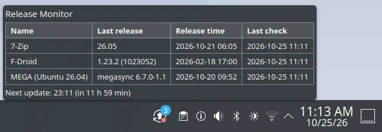
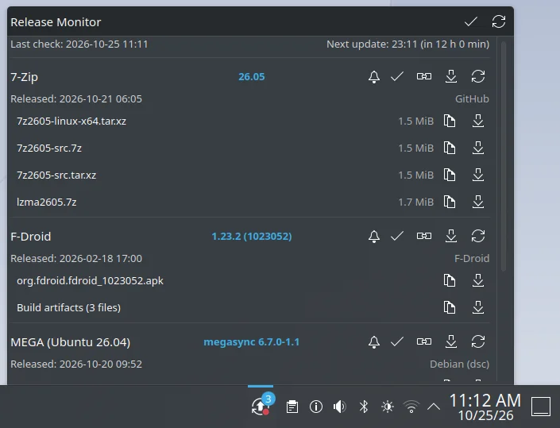
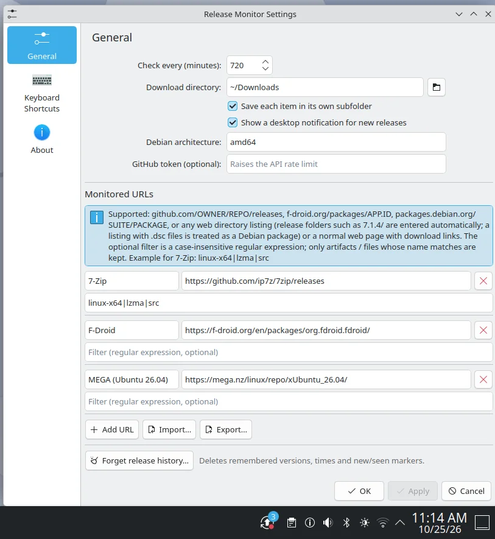

# Release Monitor (KDE Plasma 6)

## Description
Panel/tray widget that watches URLs for new releases, notifies you, and downloads artifacts.

It can notify if there are new releases of defined source.

You can see more details regarding the sources in the popup view:

You can configure source in configuration interface:

More screenshots are in: [docs](docs)

##
Supported sources
- GitHub releases page (`https://github.com/OWNER/REPO/releases`) - uses the GitHub REST API
- F-Droid package page (`https://f-droid.org/packages/APP.ID/`) - uses the F-Droid API (+ page for date)
- Debian package page (`https://packages.debian.org/SUITE/PACKAGE`)
- Any plain HTTP directory listing (Apache / nginx style autoindex)

## Install / test
    kpackagetool6 -t Plasma/Applet -i .        # or -u . to upgrade
    plasmoidviewer -a com.github.releasemonitor
    plasmawindowed com.github.releasemonitor
    systemctl --user restart plasma-plasmashell.service   # after install/upgrade
Remove: `kpackagetool6 -t Plasma/Applet -r com.github.releasemonitor`

Build a distributable archive: `zip -r ../release-monitor.plasmoid .` (run inside this folder).

## Notes
- Downloads use `curl` (must be installed); files are written as `*.part` then renamed.
- "Release time" falls back to the moment the widget first saw the release when the source doesn't expose one (marked with `*`).
- Directory listings: a release is "new" when the newest entry (by date, else by natural name order) changes. Point the URL at the directory that holds the packages, or use the filter, so that unrelated files (e.g. a re-signed `Release.key`) don't trigger false positives.
- Middle-click the icon = check now.
